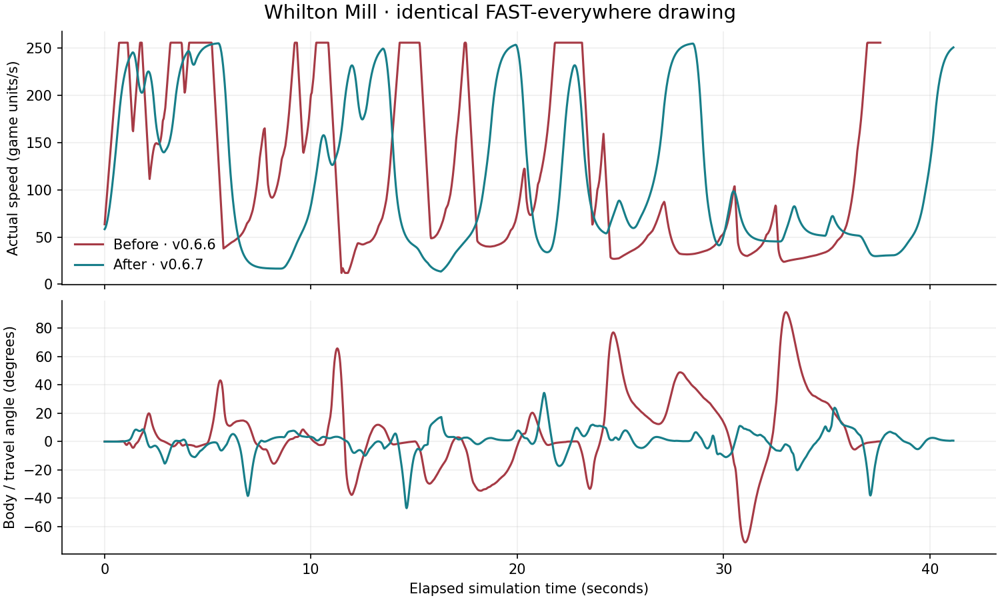

# Corner smoothness and pace feedback — v0.6.7

## Finding

The v0.6.6 model combined motor-speed damping for corner overload with a separate corner/recovery movement-speed multiplier. It also applied runoff losses twice and penalized displacement from the drawn line. The actual speed controller switched directly between acceleration and braking limits. Body steering aimed at route heading while velocity could be travelling in a substantially different direction. These are code-driven contributors to the reported jitter, alongside intentional corner grip losses; the original iPad symptom has not been observed directly.

No full physical stops occurred in the inspected baseline FAST traces: minimum actual speeds were 12–31 game units/s. Some frames had no increase in projected route progress while the car continued moving sideways or wide. That is different from the car being stopped in world space.

## Changes

- Apply the corner penalty once through a bounded corner-pace target, then approach it continuously. Remove the redundant motor-speed scrub, runoff damping and drawn-line-offset speed penalty. Surface drag and corner-exit recovery remain.
- Rate-limit acceleration changes, with proportional speed-target tracking. Initialize velocity once per car rather than reinitializing it whenever velocity is near zero.
- Guide body yaw toward physical travel direction plus rear slip, filtering the heading target. Remove the superseded route-heading steering calculations. Available grip still bounds physical turning; this does not snap car position to the line.
- Distinguish the requested speed plan's grip demand from actual corner load. Show understeer when actual motion exceeds available corner grip; otherwise explain an over-ambitious speed plan as a corner-speed penalty.
- Show persistent feedback for drawn-line braking, understeer, corner-speed penalty, rear slide, runoff, grip recovery and spins, plus actual pace as a percentage of the drawn target. Hold brief state transitions for 0.3 s so text does not flicker. Local feedback explicitly follows Player 1.
- Record one primary condition per simulation step. Final breakdowns show condition-active durations, not estimated seconds added to lap time. Each local car has independent counters.
- Keep older records in their existing namespace; v0.6.7 starts a separate record set because handling has changed.

## Validation

Run `node rally-cross-x/tests/handling.cjs`. The production-physics harness now checks 22 full laps across all 11 circuits, braking/FAST tradeoffs, finite motion, step-size stability, deterministic replay, displaced-car continuity, 2/8-player matches, AI, feedback priorities/hold time and low-speed initialization. It also asserts speed-transition continuity, no unexpected hard stops, reasonable body/travel alignment, and condition durations covering each race exactly once.

With identical FAST-everywhere centreline drawings and 20 ms steps, rapid speed reversals fell from 11/7/7/15 to zero on Brands RX, Tsukuba, Snow Park and Whilton Mill. A reversal is an acceleration sign change with magnitude over 20 game units/s². Peak change in acceleration fell from approximately 20,335–29,744 to 1,010–1,597 game units/s³. This measures control smoothness, not rendering performance.

Some lap times increase as physical travel and line recovery change. FAST on snow can still be severely penalized. The braking profile still beats FAST everywhere on the two asserted technical circuits, while FAST wins on the open Daytona oval. Tests use original synthetic paths, not recovered Draw Race recordings.

The curves show the same input drawing on elapsed-time axes; corresponding corners occur at different times. See [full results](handling-results-v0.6.7.csv). Browser/iPad animation and touch feel still require device validation.
